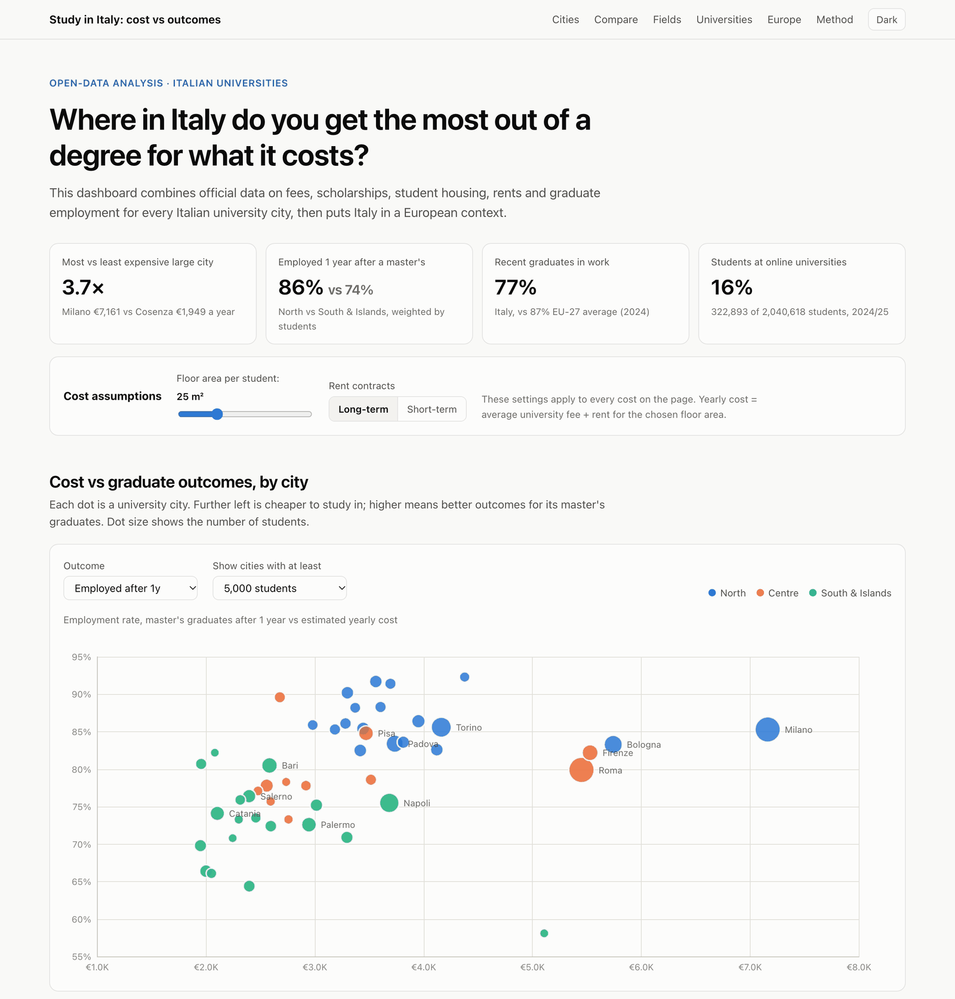
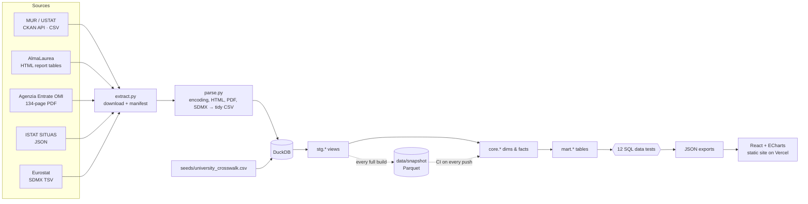

# Study in Italy: cost vs outcomes

**Where in Italy do you get the most out of a university degree for what it costs?**

An end-to-end open-data project. It combines five official sources on Italian universities: fees, scholarships,
student housing, rents and graduate employment. A Python + DuckDB pipeline cleans and models the data, data tests
check every build, and the result is an interactive dashboard that compares cities, universities and fields of
study, with Italy set in a European context.

> **Live dashboard:** [study-in-italy-dashboard.vercel.app](https://study-in-italy-dashboard.vercel.app)

   [](https://github.com/hakan-ay/eu-education-expenses-comparison/actions/workflows/ci.yml)

<a href="https://study-in-italy-dashboard.vercel.app">
  <picture>
    <source media="(prefers-color-scheme: dark)" srcset="docs/dashboard-dark.png">
    
  </picture>
</a>

---

## Key findings

_Data as of October 2026: AlmaLaurea 2025 survey, MUR 2024/25 enrolment, OMI 2025 rents. The dashboard computes
these numbers live, so they update when the data is refreshed._

| | |
|---|---|
| **Milan costs 3.7× as much as Cosenza** | With a 25 m² share of a flat, fee + rent comes to about €7,200 a year in Milan vs €1,950 in Cosenza. Rent explains almost all of the difference: average public-university fees range only from about €700 to €2,300. |
| **…but five years on, almost everyone is employed** | Five years after a master's degree, 86–98% of graduates are employed in every large university city. The gap between regions is real at **one year** (≈86% in the North vs ≈74% in the South & Islands) and narrows over time. |
| **Northern mid-sized cities are the value spot** | Bergamo, Brescia, Verona, Ancona and Trieste combine top-quartile employment (96–98% after 5 years) with yearly costs about half of Milan's. |
| **Field matters as much as city** | One year after a master's, employment ranges from 62% (Psychology) to 94% (Engineering, ICT). Salary gaps between fields are about 1.5× the gaps between cities. |
| **Italy is last in the EU for graduate employment** | Only 77% of recent Italian tertiary graduates are employed (EU-27: 87%, rank 27 of 27), even though Italy's price level is close to the EU average. |
| **Online universities are booming** | Telematic universities grew from 62k students (2015/16) to 323k (2024/25), now **16%** of all enrolment. |

## What's in the dashboard

| Section | Answers |
|---|---|
| **Cost vs outcomes** | A scatter of all 54 university cities: estimated yearly cost vs employment or salary, with a sortable table |
| **Compare cities** | Up to three cities side by side: cost breakdown, enrolment trend (indexed), 15 metrics |
| **Fields of study** | Employment and salary for 15 field groups × 4 graduate cohorts, plus "where to study field X" |
| **Universities** | Searchable table of 92 institutions (public, private, online) |
| **Italy in Europe** | Italy vs the 26 other EU countries on four Eurostat indicators |
| **Methodology** | Cost model, coverage caveats, reference periods and the live data-test results |

Two global controls apply to every cost on the page: the **floor area per student** (m²) and the **rent contract
type** (long-term or short-term OMI market).

---

## Architecture



| Layer | Where | What happens |
|---|---|---|
| Extract | [`pipeline/extract.py`](pipeline/extract.py) | Downloads 28 files. MUR resources are resolved through the CKAN API by name, because the portal renames files when it publishes corrections (`…_rett20260626.csv`). Writes a provenance manifest (URL, checksum, timestamp). |
| Parse | [`pipeline/parse.py`](pipeline/parse.py) | Turns non-tabular sources into tidy CSVs and normalises encodings. |
| Staging | [`pipeline/sql/01_staging.sql`](pipeline/sql/01_staging.sql) | One view per source: renaming, typing and light cleaning only. |
| Core | [`pipeline/sql/02_core.sql`](pipeline/sql/02_core.sql) | Conformed dimensions (university, city, field) and facts. All business rules live here. |
| Marts | [`pipeline/sql/03_marts.sql`](pipeline/sql/03_marts.sql) | One table per dashboard view, with weighted aggregations. |
| Tests | [`pipeline/sql/tests/`](pipeline/sql/tests) | 12 assertion queries that must return zero rows; the build fails otherwise. |
| Snapshot | [`data/snapshot/`](data/snapshot) | Every full build saves the 20 staging views as Parquet (~0.6 MB, committed), so the model can be rebuilt and tested without downloading the sources. |
| CI | [`.github/workflows/ci.yml`](.github/workflows/ci.yml) | On every push: rebuild core + marts from the snapshot, run the 12 data tests, check that the committed JSON is exactly what the SQL produces, then lint and build the dashboard. |
| Web | [`web/`](web) | Vite + React + TypeScript + ECharts. Static, no backend. |

## Data cleaning: the interesting part

Real public data is messy. These are the problems this pipeline solves, and where:

1. **Three identifier schemes for the same university.** MUR fee files use zero-padded 5-digit codes (`00101`), the
   USTAT series use integers (`101`), and AlmaLaurea uses display names with footnote markers
   (`Milano Humanitas (1)`, `Roma Link(1) (2)`). They are reconciled by a hand-reviewed
   [crosswalk seed](data/seeds/university_crosswalk.csv) of 101 rows. Tests guarantee that every active university
   and every AlmaLaurea entity is matched, so nothing is dropped silently.
2. **Mixed file encodings.** MUR publishes UTF-8, ISO-8859-1 and Windows-1252 files side by side. Windows-1252 curly
   apostrophes break a Latin-1 reader, so every file is detected and re-encoded to UTF-8 first.
3. **Italian number formats.** `1.285` is one thousand two hundred eighty-five and `64,9` is a decimal. Parsed
   naively, AlmaLaurea's response rate of `64,9%` becomes `649`. Handled with a `it_num()` SQL macro and
   `read_html(decimal=",", thousands=".")`.
4. **Wide report tables with heading rows.** AlmaLaurea tables have one column per university and rows such as
   *"Tasso di occupazione"* that are headings for *"Uomini / Donne / Totale"* below them. The parser carries the
   heading down, melts the table to long format, and maps about 10 Italian indicator labels to stable English metric
   names.
5. **Rents that only exist inside a PDF.** OMI publishes rent per m² in report tables. A regex parser reads 12 tables
   (4 contract types × city / region / macro-area) and asserts the expected row counts, so a layout change fails
   loudly instead of producing wrong numbers.
6. **Regional averages dominated by one city.** Lombardy's average rent is pulled up by Milan, so pricing Bergamo
   at the Lombardy average would be wrong. Using OMI's totals, the model derives the **region excluding its big
   city**: (region rent total − city rent total) ÷ (region m² − city m²). Bergamo's rent drops from €111 to €83 per
   m² per year.
7. **Zeros that mean "not reported".** Veneto's student-support agencies report 0 applications and 0 scholarships
   for Padova, Verona and Venezia, because those universities run scholarships themselves. These are set to NULL,
   not treated as a 0% grant rate.
8. **Total rows mixed with detail rows** (`TTTTT` Italy, `SSSSS` state, `LLLLL` private), padded codes (`"01 "`,
   `"2023-2024 "`) and Eurostat value flags (`": c"`, `"12.3 b"`) are all handled in staging.
9. **Coverage gaps are measured, not hidden.** AlmaLaurea doesn't cover Politecnico di Milano, Bocconi, Cattolica
   or Luiss, so Milan's outcome figures represent 51% of its students. Every city shows its coverage, and a test
   requires overall coverage to stay above 80%.

## Data model

```
stg.*   (20 views)  ──►  core.dim_university   core.dim_city (with rent reference)   core.dim_field
                         core.fct_enrolment    core.fct_enrolment_field
                         core.fct_university_support (fees, grants, housing)
                         core.fct_outcomes_{university,field,national}
                         core.fct_city_beds    core.fct_eu_country_year
                    ──►  mart.city_comparison  mart.university_profile  mart.field_outcomes
                         mart.city_field_enrolment  mart.city_enrolment_trend
                         mart.eu_country_latest  mart.eu_country_series
```

**Weighting rules.** City fees are averaged over the city's public universities, weighted by enrolment. Private
fees are used only where a city has no public university, and are tagged in the UI. City outcomes are averaged
over universities, weighted by AlmaLaurea respondents.

**Cost model.** Yearly cost = average fee of fee-paying students + OMI rent per m² per year × floor area. It is
built for **comparing** cities, not for budgeting:
- OMI rents come from all registered contracts, including long-running ones, so they sit below current asking
  prices for student rooms.
- Students under the ISEE no-tax threshold pay no fee.
- Food and transport are excluded, because no official source publishes them by city. Numbeo was considered and
  rejected because its terms don't allow reuse.

## Sources

| Source | Used for | Reference period |
|---|---|---|
| [MUR – USTAT open data](https://dati-ustat.mur.gov.it/) | Enrolment, fees, scholarships (DSU), student beds, university registry, field groups | a.y. 2023/24 (fees, DSU), 2024/25 (enrolment) |
| [AlmaLaurea](https://www.almalaurea.it/i-dati/le-nostre-indagini/condizione-occupazionale-laureati) | Employment, salary and job quality 1 and 5 years after graduation | 2025 survey |
| [Agenzia delle Entrate – OMI](https://www.agenziaentrate.gov.it/portale/web/guest/schede/fabbricatiterreni/omi/pubblicazioni/rapporti-immobiliari-residenziali) | Rent per m² by city / region and contract type | contracts registered in 2025 |
| [ISTAT – SITUAS](https://situas.istat.it/) | Municipality → province → region → macro-area | 1 Jan 2026 |
| [Eurostat](https://ec.europa.eu/eurostat/data/database) | `prc_ppp_ind`, `edat_lfse_24`, `edat_lfse_03`, `educ_uoe_mobs02`, `educ_uoe_enrt01` | latest (2024) |

The exact URL and retrieval date of every file is in [`data/sources_manifest.json`](data/sources_manifest.json).
AlmaLaurea data may be reproduced for non-commercial purposes with attribution; OMI data must be cited as
"Agenzia Entrate – OMI".

## Run it yourself

Requires Python 3.11+ and Node 20+.

```bash
make setup   # venv + pip install, npm ci
make data    # extract → parse → DuckDB model → tests → web/public/data/*.json  (~2 min)
make dev     # http://localhost:5173
make test    # rebuild from data/snapshot/ and run the data tests, no downloads (this is what CI runs)
```

**What CI covers, and what it doesn't.** CI checks every change to the SQL, the snapshot, the exported JSON and
the dashboard code. It does not download the sources, so a change at a publisher (a new file layout, revised
figures) only shows up when `make data` is run; that run also refreshes the snapshot, and the diff shows what moved.

The exported JSON is committed, so the dashboard also runs without the Python steps:
`cd web && npm ci && npm run dev`.

To explore the warehouse with SQL after `make data`:

```bash
duckdb data/warehouse.duckdb -c "select study_city, reference_fee_eur, rent_sqm_year, employment_rate_master_5y from mart.city_comparison order by students desc limit 10"
```

## Deploy

The dashboard is a static site. On [Vercel](https://vercel.com/new): import the GitHub repository, set **Root
Directory** to `web`, and keep the detected Vite settings (`npm run build` → `dist`). After that, every push to
`main` redeploys. A custom domain can be added under *Project → Settings → Domains*.

## Repository layout

```
pipeline/
  sources.py          catalogue of every external source
  extract.py          download + provenance manifest
  parse.py            HTML / PDF / SDMX / encoding → tidy CSV
  build.py            run SQL models, run tests, export JSON + snapshot
  sql/                00_macros · 01_staging · 02_core · 03_marts · tests/
data/
  seeds/              hand-maintained crosswalk (reviewed, tested)
  snapshot/           staging views as Parquet (written by every full build, used by CI)
  sources_manifest.json
  raw/ interim/       (git-ignored, recreated by `make data`)
docs/                 README screenshots (light / dark)
.github/workflows/    CI: data tests on the snapshot, dashboard lint + build
web/
  public/data/        exported marts (committed)
  src/                React app: sections/, components/
```

## Roadmap

- City-level rents for every provincial capital from the OMI zone database (needs a free SPID login on the
  Agenzia Entrate portal).
- Fee trend 2019–2024 from earlier MUR releases.
- Outcomes by university × field (AlmaLaurea supports this breakdown; 80 more requests).
- Add other countries' university-level data (e.g. Spain's SIIU, Germany's Destatis) for the EU section.

## License

Code: [MIT](LICENSE). Data: © the respective publishers, used under their terms (see Sources).

Built by [Hakan Ay](https://github.com/hakan-ay).
